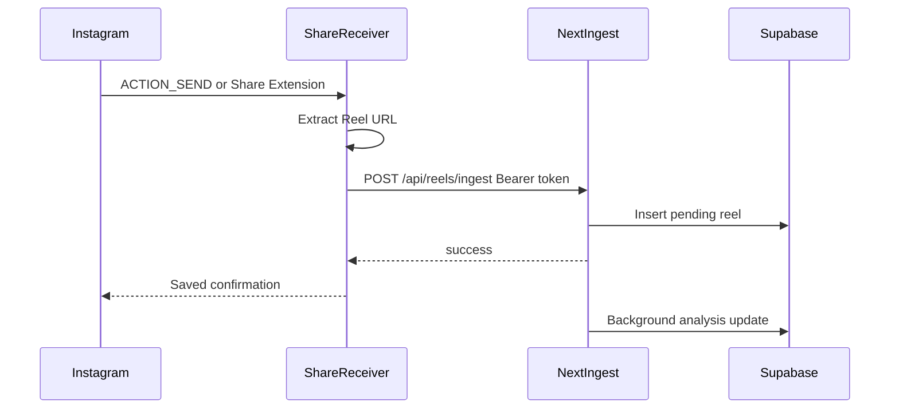

# Recall mobile app

The website remains the source of truth. The Expo app in `mobile/` is a share target that saves Instagram Reels into the same Supabase account.

## Architecture

- Website save (full analysis, waits for completion): `POST /api/reels/process`
- Share save (persist URL quickly, analyze in the background): `POST /api/reels/ingest`
- Auth: same Supabase email/password users. The website uses cookies. Mobile and share receivers send `Authorization: Bearer <access_token>`.
- Success from share means the **Reel URL was stored** for that account. Video download and AI summary continue on the server (`processing_status`: `pending` → `completed` or `failed`).



## Local Windows test (fastest)

Website (works now, no Android SDK required):

```powershell
powershell -ExecutionPolicy Bypass -File scripts/setup-local.ps1
npm install
npm run dev
```

Open http://localhost:3000 → log in with your Recall account → paste a Reel URL on the home page → confirm it appears in Library.

Share-to-save on a phone still needs a development build (Expo Go cannot be a share target):

```powershell
cd mobile
npm install
npx expo prebuild --platform android
npx expo run:android
```

That last step needs Android Studio / SDK. This machine currently has Node, but no Android SDK, so Instagram share-sheet QA cannot be completed here until Android Studio is installed.

Phone API URL written by `scripts/setup-local.ps1` is `http://<your-lan-ip>:3000`. Keep the PC and phone on the same Wi-Fi, and allow port 3000 inbound if Windows Firewall prompts.

## Configure

Copy `mobile/.env.example` to `mobile/.env`:

```
EXPO_PUBLIC_API_URL=https://your-deployed-recall-site
EXPO_PUBLIC_SUPABASE_URL=https://your-project.supabase.co
EXPO_PUBLIC_SUPABASE_ANON_KEY=your-anon-key
```

`EXPO_PUBLIC_API_URL` must be the public website origin (no trailing slash). Local Android emulators cannot reach `localhost` of the host without `10.0.2.2` or a tunnel.

Optional SQL to enforce uniqueness: `supabase_share_dedupe.sql`.

## Native share receivers

Android (in the Expo module, autolinked):

- [`mobile/modules/recall-native/android/.../share/ShareActivity.kt`](mobile/modules/recall-native/android/src/main/java/expo/modules/recallnative/share/ShareActivity.kt) — translucent `ACTION_SEND` target; starts a foreground service and finishes immediately.
- [`ShareSaveService.kt`](mobile/modules/recall-native/android/src/main/java/expo/modules/recallnative/share/ShareSaveService.kt) — posts `POST /api/reels/ingest`, then notifies `Reel saved to Recall ✓`.
- Session tokens are written by `RecallNative.setSession` into app-private SharedPreferences so the service can save without opening the JS UI.

iOS:

- [`mobile/native/ios/ShareExtension/ShareViewController.swift`](mobile/native/ios/ShareExtension/ShareViewController.swift) — genuine Share Extension UI (copied into the Xcode project by [`mobile/plugins/withRecallShare.js`](mobile/plugins/withRecallShare.js) during `expo prebuild`).
- Tokens are stored in App Group `group.com.recall.app` (UserDefaults). The main app writes them; the extension reads them.

## Native identifiers

- Android applicationId / iOS bundle id: `com.recall.app`
- iOS App Group: `group.com.recall.app`
- iOS Share Extension bundle id: `com.recall.app.ShareExtension`

Change these in `mobile/app.json` (and the App Group strings in native files) before shipping. Apple requires an App Group on the developer portal that matches `group.com.recall.app`.

## Build (development client — Expo Go cannot host share targets)

```bash
cd mobile
npm install
npx expo prebuild
npx expo run:android
# on macOS with Xcode:
npx expo run:ios
```

Do not use Expo Go for share-to-save. Use a development build or a release build.

### Android signing / permissions

- `POST_NOTIFICATIONS` is requested in the main app. If the user denies it, saves still run; confirmation may be silent.
- Foreground service type: `dataSync`.
- Instagram share payload handled: `ACTION_SEND` + `text/plain`.

### iOS signing

- Enable App Groups for the main app and Share Extension.
- The Share Extension UI is the confirmation surface. iOS does not reliably allow an independent system notification from an extension.

## Product flow

Normal path (signed in):

1. Instagram Reel → Share → Recall
2. Android: translucent share activity starts a foreground service and finishes so Instagram can stay up. Notification after the server confirms: `Reel saved to Recall ✓`
3. iOS: Share Extension posts the URL, shows `Reel saved to Recall ✓`, dismisses back to Instagram. The main app is not launched.

If the user is not signed in, the URL is stored as pending. Android opens the main app for login. iOS asks the user to open Recall, then retries the stored URL after sign-in.

## Tests

Website URL parser:

```bash
npm test
```

Mobile URL parser:

```bash
cd mobile
npm test
```

### Real-device verification (not run in this environment)

The following still need a physical Android and iOS device with Instagram installed:

1. Recall appears in Instagram's share sheet
2. The correct Reel URL is received
3. The row appears for the same user on the website
4. Android does not keep the main Recall UI in the foreground
5. iOS extension dismisses to Instagram
6. Success copy appears only after HTTP success
7. Duplicate shares return `duplicate: true` and do not insert a second row
8. Invalid URLs and offline failures keep the URL for retry
9. Expired sessions keep the URL and require sign-in

Until those are executed on hardware, treat share-target QA as incomplete.

## Limitations

- Instagram does not offer an official “saved Reels” webhook. Capture is share-sheet based, not Instagram’s own bookmark.
- `/api/reels/ingest` may not finish AI analysis if the host kills the request after the HTTP response (`after()`). The URL row still exists.
- Overlaying a bubble on top of Instagram is not implemented (and is not allowed on iOS).
